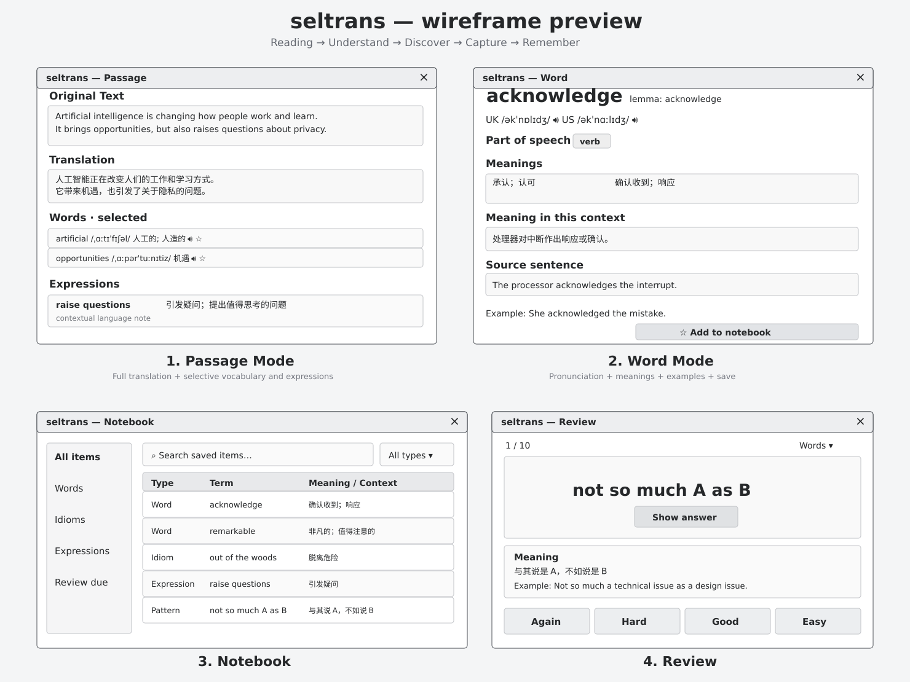

# UI References

## Initial wireframe

The wireframe presents four conceptual views:

1. **Passage Mode** — original, natural translation, a small list of selected difficult words, and useful expressions/language notes.
2. **Word Mode** — headword/lemma, UK/US pronunciation, definitions, contextual meaning, source sentence, examples, and one-click save.
3. **Notebook** — saved words, idioms, phrasal verbs, expressions and patterns with reading context and review status.
4. **Review** — a recall-first learning card with spaced repetition.

This is a **directional UX reference**, not a final GTK layout or exact screen specification. The SVG is a vector rendering of the four-panel concept and can be adapted to libadwaita design conventions.

## Important interaction details not visible in the wireframe

- User selects text in Papers, Firefox, terminal, or editor, then presses **Alt+Q**.
- On first use, seltrans must already be running in **manual-resident** mode.
- After that, repeated shortcuts send selected text to the resident app over IPC.
- **The same existing result window** is refreshed; do not cold-start GTK or create one window per invocation.
- Selection capture precedes moving focus to the result window.
- Paragraph mode keeps vocabulary selective, while showing meaningful idioms, slang, phrasal verbs, collocations and unusual sentence patterns.
- Only explicit user saves create learning items; no passive clipboard logging.
- Notebook/review are planned major surfaces, not all required in M1.

See [ADR 0001](adr/0001-resident-shortcut-model.md) and [Product Requirements](PRODUCT.md).
